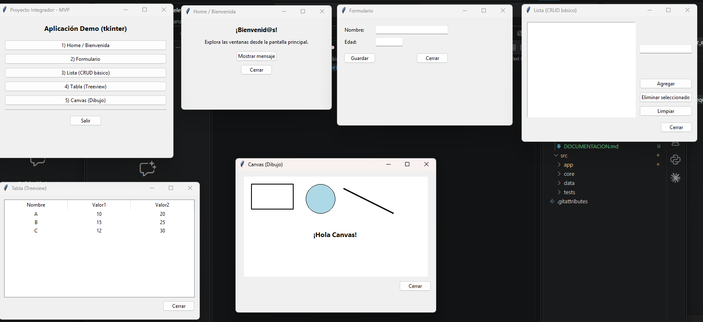

# Skeleton de 5 ventanas con tkinter – Proyecto Integrador (MVP)

Aplicación de escritorio en **Python + tkinter** con una ventana principal que navega a 5 subventanas. Cada subventana muestra un componente distinto: bienvenida, formulario con validación, lista CRUD, tabla desde CSV y dibujo en canvas.



---

## 👥 Equipo y roles

| Integrante | Rol | Ventana implementada | Responsabilidades en esta entrega |
|---|---|---|---|
| **Roel** | 🧑‍💻 Líder Técnico (Tech Lead) | `main.py` + `win_canvas.py` | Estructura de carpetas, `launch.json`, integración de las 5 ventanas en el menú principal y ventana de Canvas. Revisa que el código cumpla estándares y corra sin errores de import. |
| **Fabian** | 👩‍💼 Product Owner (PO) | `win_home.py` | Ventana de bienvenida. Define qué debe mostrar cada ventana, organiza el trabajo en el tablero Kanban y valida que el entregable cumpla los criterios. |
| **Jesús** | 🖥️ Desarrollador UI | `win_form.py` | Formulario con campos Nombre y Edad, mensajes de error claros y guardado en `.txt`. Cuida que la interfaz sea clara y fácil de usar. |
| **Dariush** | 📊 Desarrollador de Datos/API | `win_table.py` + `data/sample.csv` | Lectura del archivo CSV con `csv.DictReader` y su presentación en un `Treeview`. Prepara los datos de ejemplo. |
| **Axel** | 🧪 QA / Analista de Pruebas | `win_list.py` | Lista CRUD (agregar, eliminar, limpiar). Ejecuta pruebas de caja negra en las 5 ventanas y documenta resultados y evidencias (capturas). |

---

## 📁 Estructura del repositorio

```
/
├── .vscode/
│   └── launch.json              # Ejecutar con F5 (PYTHONPATH=src)
├── data/
│   └── sample.csv               # Datos de ejemplo para la tabla
├── docs/
│   ├── 04_skeleton_5_ventanas_tkinter_equipo.md
│   └── captura_ventanas.png
└── src/
    └── app/
        ├── main.py              # Ventana principal (menú)
        ├── win_home.py          # 1) Home / Bienvenida
        ├── win_form.py          # 2) Formulario
        ├── win_list.py          # 3) Lista (CRUD básico)
        ├── win_table.py         # 4) Tabla (Treeview)
        └── win_canvas.py        # 5) Canvas (Dibujo)
```

---

## ▶️ Pasos para ejecutar

### 1. Clonar el repositorio
```powershell
git clone <URL-del-repositorio>
```
Ábrelo en VS Code (Archivo → Abrir carpeta → la raíz del repo).

### 2. (Opcional) Crear y activar entorno virtual
```powershell
python -m venv .venv
Set-ExecutionPolicy -ExecutionPolicy RemoteSigned -Scope CurrentUser   # solo la primera vez
.\.venv\Scripts\Activate
```
No se necesita instalar librerías: `tkinter` viene incluido con Python.

### 3. Seleccionar el intérprete
`Ctrl+Shift+P` → **Python: Select Interpreter** → el de `.venv` (o tu Python 3).

### 4. Ejecutar
- **Desde VS Code:** pestaña *Run and Debug* → configuración **"Programa con PYTHONPATH=src"** → **F5**.
- **Desde terminal:**
  ```powershell
  cd src
  python -m app.main
  ```

---

## 🪟 Descripción de las ventanas

### `main.py` – Ventana principal
Crea la ventana raíz (`tk.Tk`) con 5 botones. Cada botón abre su subventana con `command=lambda: open_win_xxx(root)`. El botón **Salir** cierra la app y `root.mainloop()` mantiene la aplicación escuchando eventos.

Todas las subventanas siguen el mismo patrón: una función `open_win_xxx(parent)` que crea un `tk.Toplevel`, le asigna título y tamaño, agrega un `ttk.Frame` con sus widgets y un botón **Cerrar**.

### 1) `win_home.py` – Home / Bienvenida
Etiquetas de bienvenida y un botón **Mostrar mensaje** que abre un `messagebox.showinfo`.
*Componentes:* `Label`, `Button`, `messagebox`.

### 2) `win_form.py` – Formulario + validación
Campos **Nombre** y **Edad** organizados con `grid`. Al presionar **Guardar**:
1. Valida que el nombre no esté vacío.
2. Valida que la edad sea un número entero (`isdigit()`).
3. Abre un diálogo **Guardar como** y escribe los datos en un archivo `.txt`.

*Componentes:* `Entry`, `grid`, `messagebox`, `filedialog`, escritura de archivos.

### 3) `win_list.py` – Lista (CRUD básico)
`Listbox` con botones **Agregar** (desde un `Entry`), **Eliminar seleccionado** y **Limpiar**. Si se intenta agregar un texto vacío muestra un aviso.
*Componentes:* `Listbox`, `curselection()`, `insert`/`delete`.

### 4) `win_table.py` – Tabla desde CSV
`ttk.Treeview` con columnas *Nombre, Valor1, Valor2*. Lee `data/sample.csv` con `csv.DictReader` usando una ruta construida con `pathlib` (`parents[2]` = raíz del repo), así funciona sin importar desde qué carpeta se ejecute.
*Componentes:* `Treeview`, `csv`, `pathlib`.

### 5) `win_canvas.py` – Canvas (Dibujo)
`tk.Canvas` blanco donde se dibujan un rectángulo, un óvalo, una línea y un texto. Las coordenadas parten de `(0,0)` en la esquina superior izquierda.
*Componentes:* `create_rectangle`, `create_oval`, `create_line`, `create_text`.

---

## 🧪 Pruebas realizadas (QA)

| # | Prueba | Resultado esperado | Resultado |
|---|---|---|---|
| 1 | Abrir cada botón del menú principal | Se abre la subventana correspondiente | ✅ |
| 2 | Home → *Mostrar mensaje* | Aparece "¡Equipo listo!" | ✅ |
| 3 | Formulario con nombre vacío | Error "El nombre es requerido." | ✅ |
| 4 | Formulario con edad "abc" | Error "La edad debe ser un número entero." | ✅ |
| 5 | Formulario con datos válidos | Se guarda el `.txt` y aparece "Datos guardados." | ✅ |
| 6 | Lista → *Agregar* con texto vacío | Aviso "Escribe un texto para agregar." | ✅ |
| 7 | Lista → agregar, eliminar y limpiar | La lista se actualiza correctamente | ✅ |
| 8 | Tabla | Muestra las filas A, B y C del CSV | ✅ |
| 9 | Canvas | Se ven las 4 figuras | ✅ |
| 10 | Ejecutar con F5 desde VS Code | Sin errores de import | ✅ |

---

## 🛠️ Solución de problemas

| Problema | Solución |
|---|---|
| `No module named 'app'` | Ejecutar con F5 (usa `PYTHONPATH=src`) o desde `src/` con `python -m app.main`. |
| No se puede activar `.venv` en PowerShell | `Set-ExecutionPolicy -ExecutionPolicy RemoteSigned -Scope CurrentUser` |
| VS Code usa otro Python | `Ctrl+Shift+P` → *Python: Select Interpreter* → `.venv` |
| La tabla no muestra datos | Verificar que exista `data/sample.csv` en la raíz del repo. |
| No se abre la ventana | Confirmar que `main.py` llama a `root.mainloop()` y revisar la terminal. |
