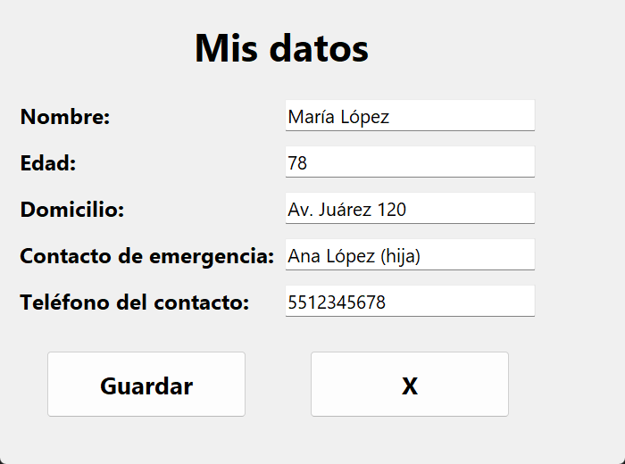
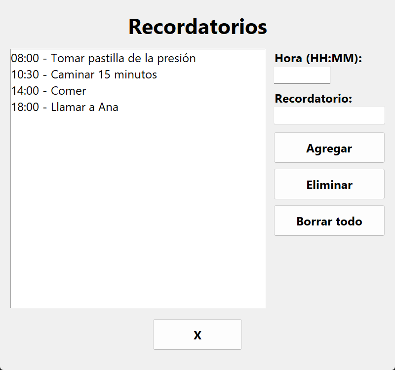

# Adaptación de win_form y win_list

## Asignación de ventanas (1 por integrante)

| Integrante | Ventana |
|---|---|
| Fabian Emanuel Sierra Cruz | win_home.py |
| Roel Andre Pimentel De la Rosa | win_form.py |
| Roel Andre Pimentel De la Rosa | win_list.py |
| Dariush Moetamedi Nava | win_table.py |
| Jesús Lara Soto | main.py |
| Jesús Lara Soto | win_canvas.py |

## Cambios aplicados

### Cambio en win_form.py → "Mis datos"

- La ventana ahora se llama **Mis datos** y sirve para guardar la información básica del paciente.
- Se agregaron más campos además de Nombre y Edad: **Domicilio**, **Contacto de emergencia** y **Teléfono del contacto**. Los campos se crean con un `for` para no repetir código.
- Se mantuvieron las validaciones del nombre y la edad, y se agregó que el teléfono solo acepte números.
- Antes se abría un cuadro de "Guardar como". Ahora los datos se guardan directo en `data/mis_datos.txt`, así el paciente o el cuidador no tienen que buscar dónde guardar.
- Cuando se abre la ventana se cargan los datos que ya estaban guardados, para que el paciente pueda consultar su información en cualquier momento.
- Se aumentó el tamaño de la letra y de los botones, y se puso el botón **X** para cerrar, igual que en main y canvas.

### Cambio en win_list.py → "Recordatorios"

- La lista ahora se usa para los **recordatorios** del paciente (tomar medicina, comer, llamar a un familiar, etc.).
- Se agregó un campo de **hora** (formato HH:MM, opcional). Si la hora está mal escrita (por ejemplo 25:00) aparece un mensaje de error.
- Los recordatorios se guardan en `data/recordatorios.txt` cada vez que se agrega o se borra uno, así no se pierden al cerrar el programa.
- El botón **Limpiar** ahora se llama **Borrar todo** y pregunta antes de borrar, para evitar que el paciente borre todo por accidente.
- Si se presiona **Eliminar** sin seleccionar nada, aparece un aviso.
- Letra grande en la lista y en los botones, y botón **X** para cerrar.

### Otros cambios

- Se agregó un archivo `.gitignore` para que `mis_datos.txt` y `recordatorios.txt` no se suban al repositorio, porque tienen datos personales del paciente.

## Pruebas realizadas

| # | Prueba | Resultado esperado | Resultado |
|---|---|---|---|
| 1 | Mis datos → Guardar con nombre vacío | Error "El nombre es requerido." | ✅ |
| 2 | Mis datos → Edad "abc" | Error "La edad debe ser un número entero." | ✅ |
| 3 | Mis datos → Datos válidos | Se guarda el archivo y aparece "Datos guardados." | ✅ |
| 4 | Mis datos → Cerrar y volver a abrir | Aparecen los datos guardados | ✅ |
| 5 | Recordatorios → Agregar sin texto | Aviso "Escribe un recordatorio para agregar." | ✅ |
| 6 | Recordatorios → Hora 25:00 | Error de formato de hora | ✅ |
| 7 | Recordatorios → Agregar, eliminar y borrar todo | La lista se actualiza y se guarda | ✅ |

## Reflexión

Con estos cambios las ventanas de formulario y lista ya tienen un uso real dentro de la aplicación. En **Mis datos** el paciente puede ver quién es, dónde vive y a quién llamar en caso de emergencia, algo muy importante para una persona con Alzheimer que puede desorientarse. En **Recordatorios** el cuidador puede dejar anotadas las actividades del día con su hora, y como se guardan en un archivo, siguen ahí la próxima vez que se abra el programa.

También se cuidó que las dos ventanas tengan el mismo estilo que main y canvas (letra grande y botón X), para que toda la aplicación sea fácil de usar. Más adelante se podría separar qué partes puede editar el cuidador y cuáles solo puede ver el paciente.
