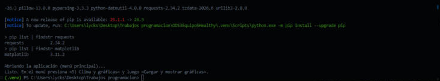
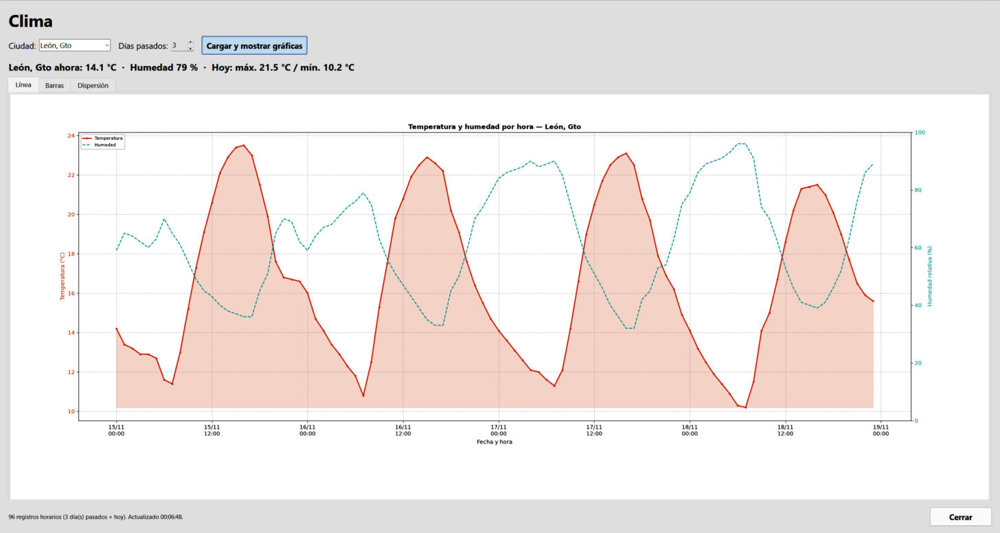
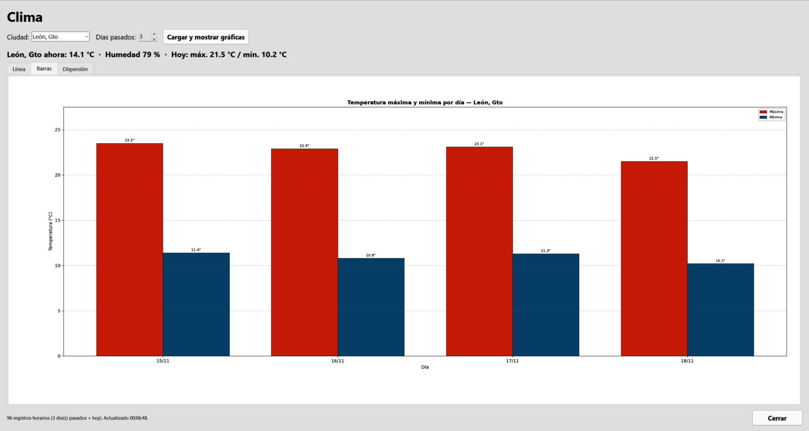
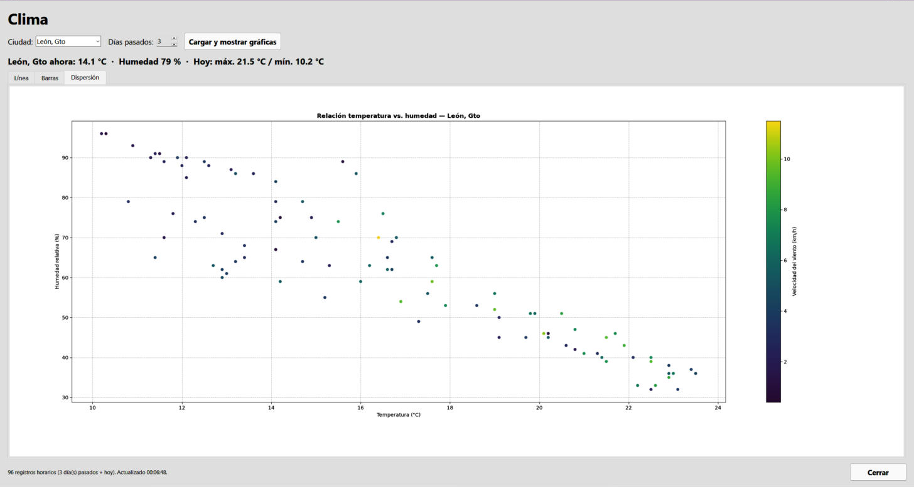

# Sesión 7: API pública + gráficas (Roel Pimentel)

**Integrante:** Roel Andre Pimentel de la Rosa (`Lycks1`)
**Archivos en el repo:** este documento, las capturas `docs/sesion7_roel_*.png` y `requirements.txt`.

> El `win_canvas.py` del repo es la versión de Jesús. Mi versión de `win_canvas.py` (distinto diseño, rango de consulta y elementos visuales) está completa en la sección 5 de este documento. Para probarla, reemplaza el contenido de `src/app/win_canvas.py` con ese código.

## 1. Instalación de librerías

Con el entorno `.venv` activo:

```powershell
pip install matplotlib requests      # o: pip install -r requirements.txt
pip list | findstr requests          # requests 2.34.2
pip list | findstr matplotlib        # matplotlib 3.11.2
```



## 2. Qué hace mi versión de la ventana 5

Mi versión de la ventana 5 es **Clima**. Se conecta a la API pública de **Open-Meteo**, que no pide autenticación, y procesa el JSON que regresa. Con esos datos dibuja **tres gráficas de matplotlib** dentro de tkinter usando `FigureCanvasTkAgg`.

Para el proyecto (apoyo a personas con Alzheimer), arriba de las gráficas hay un **resumen en letra grande** con la temperatura actual, la humedad y la máxima/mínima del día. Los adultos mayores son sensibles al calor y al frío.

## 3. Cambios respecto al código base de la sesión

### Consulta a la API (rango y parámetros distintos)

| Parámetro | Código base | Mi versión |
|---|---|---|
| Ciudad | Solo León (fija en la URL) | Seleccionable: León, Guanajuato, CDMX, Monterrey, Cancún |
| Rango | `past_days=1` | `past_days` de **1 a 7** (Spinbox) + `forecast_days=1` |
| Variables | `temperature_2m` | `temperature_2m`, `relative_humidity_2m`, `wind_speed_10m` |
| URL | Texto concatenado | Diccionario `params` en `requests.get()` |
| Errores | Un solo `except Exception` | Errores de conexión (`RequestException`) separados de errores de datos (`KeyError`, `ValueError`) |

Las horas se convierten a `datetime`, así que el eje X muestra fechas legibles (`dd/mm HH:MM`) y no texto amontonado.

### Las tres gráficas (el código base solo traía dos)

1. **Línea:** temperatura por hora con marcadores y área sombreada (`fill_between`), y la humedad en un segundo eje Y (`twinx`) con línea punteada. Tiene leyenda combinada y rejilla.
2. **Barras:** barras agrupadas con la temperatura **máxima y mínima de cada día** y el valor escrito encima de cada barra (`bar_label`).
3. **Dispersión:** temperatura vs. humedad; el **color de cada punto indica la velocidad del viento** (mapa `viridis` con barra de color).

Todas tienen título, ejes con unidades (°C, %, km/h) y rejilla punteada.

### Diseño de la ventana

- **Pestañas (`ttk.Notebook`):** una gráfica por pestaña, en lugar de apilar tres gráficas en una ventana de 1000 px.
- **Controles arriba:** ciudad, días pasados y botón «Cargar y mostrar gráficas».
- **Letra grande** (Segoe UI 16–32), con el mismo estilo `ttk` que las demás ventanas del equipo.
- **Barra de estado:** cuántos registros llegaron y la hora de actualización.
- **Corrección de un bug del código base:** cada clic en el botón agregaba gráficas nuevas debajo de las anteriores. Ahora se limpia la pestaña antes de dibujar.
- Se usa `matplotlib.figure.Figure` en lugar de `plt.subplots()` para no acumular figuras en memoria.

## 4. Capturas (datos reales de la API)





## 5. Código completo de mi `win_canvas.py`

```python
"""
win_canvas.py — 5) Clima: API pública (Open-Meteo) + gráficas con Matplotlib.
Sesión 7 — Memoria (apoyo a personas con Alzheimer), Equipo 5.

Versión de Roel Pimentel (Lycks1).

Diferencias con la versión base:
- Diseño con pestañas (ttk.Notebook): una gráfica por pestaña, ya no apiladas.
- Barra de controles: selector de ciudad y de rango de días (1 a 7 días pasados).
- Consulta más variables a la API: temperatura, humedad relativa y viento.
- Tres gráficas distintas: línea (temperatura + humedad, doble eje),
  barras (máx./mín. por día) y dispersión (temperatura vs. humedad, color = viento).
- Al volver a cargar se reemplazan las gráficas (la versión base las acumulaba).
"""

import tkinter as tk
from tkinter import ttk, messagebox
from datetime import datetime

import requests
from matplotlib.figure import Figure
import matplotlib.dates as mdates
from matplotlib.backends.backend_tkagg import FigureCanvasTkAgg

# ---------------------------------------------------------------------------
# Configuración
# ---------------------------------------------------------------------------
API_URL = "https://api.open-meteo.com/v1/forecast"

# Ciudades disponibles: nombre -> (latitud, longitud)
CIUDADES = {
    "León, Gto": (21.12, -101.68),
    "Guanajuato, Gto": (21.02, -101.26),
    "CDMX": (19.43, -99.13),
    "Monterrey, NL": (25.67, -100.31),
    "Cancún, QR": (21.16, -86.85),
}

# Paleta de colores propia
COLOR_TEMP = "#E4572E"
COLOR_HUM = "#17BEBB"
COLOR_MAX = "#E4572E"
COLOR_MIN = "#2E86AB"


# ---------------------------------------------------------------------------
# Datos
# ---------------------------------------------------------------------------
def fetch_data(lat, lon, dias):
    """
    Consulta Open-Meteo y devuelve un diccionario con listas paralelas:
    horas (datetime), temp (°C), hum (%) y viento (km/h).
    Si algo falla, muestra un mensaje y devuelve None.
    """
    params = {
        "latitude": lat,
        "longitude": lon,
        "hourly": "temperature_2m,relative_humidity_2m,wind_speed_10m",
        "past_days": dias,
        "forecast_days": 1,
        "timezone": "auto",
    }
    try:
        response = requests.get(API_URL, params=params, timeout=15)
        response.raise_for_status()
        hourly = response.json()["hourly"]

        return {
            "horas": [datetime.fromisoformat(t) for t in hourly["time"]],
            "temp": hourly["temperature_2m"],
            "hum": hourly["relative_humidity_2m"],
            "viento": hourly["wind_speed_10m"],
        }
    except requests.exceptions.RequestException as e:
        messagebox.showerror("Error de conexión", f"No se pudo consultar la API:\n{e}")
    except (KeyError, ValueError) as e:
        messagebox.showerror("Error de datos", f"La respuesta de la API no es válida:\n{e}")
    return None


def resumen_diario(horas, temps):
    """Agrupa las temperaturas por día y devuelve (etiquetas, máximos, mínimos)."""
    por_dia = {}
    for h, t in zip(horas, temps):
        if t is None:  # la API puede devolver huecos
            continue
        por_dia.setdefault(h.date(), []).append(t)

    dias = sorted(por_dia)
    etiquetas = [d.strftime("%d/%m") for d in dias]
    maximos = [max(por_dia[d]) for d in dias]
    minimos = [min(por_dia[d]) for d in dias]
    return etiquetas, maximos, minimos


# ---------------------------------------------------------------------------
# Gráficas (se usa Figure en lugar de pyplot para no acumular figuras en memoria)
# ---------------------------------------------------------------------------
def create_line_chart(datos, ciudad):
    """Gráfica de línea: temperatura y humedad por hora con dos ejes Y."""
    fig = Figure(figsize=(9, 4), dpi=100)
    ax = fig.add_subplot(111)

    ax.plot(datos["horas"], datos["temp"], color=COLOR_TEMP, linewidth=2,
            marker="o", markersize=2.5, label="Temperatura")
    ax.fill_between(datos["horas"], datos["temp"], min(t for t in datos["temp"] if t is not None),
                    color=COLOR_TEMP, alpha=0.12)
    ax.set_ylabel("Temperatura (°C)", color=COLOR_TEMP)
    ax.tick_params(axis="y", labelcolor=COLOR_TEMP)

    # Segundo eje Y para la humedad
    ax2 = ax.twinx()
    ax2.plot(datos["horas"], datos["hum"], color=COLOR_HUM, linewidth=1.5,
             linestyle="--", label="Humedad")
    ax2.set_ylabel("Humedad relativa (%)", color=COLOR_HUM)
    ax2.tick_params(axis="y", labelcolor=COLOR_HUM)
    ax2.set_ylim(0, 100)

    ax.set_title(f"Temperatura y humedad por hora — {ciudad}", fontweight="bold")
    ax.set_xlabel("Fecha y hora")
    ax.grid(True, linestyle="--", alpha=0.4)

    # Etiquetas del eje X legibles: día/mes y hora
    ax.xaxis.set_major_formatter(mdates.DateFormatter("%d/%m\n%H:%M"))

    # Leyenda combinada de ambos ejes
    l1, n1 = ax.get_legend_handles_labels()
    l2, n2 = ax2.get_legend_handles_labels()
    ax.legend(l1 + l2, n1 + n2, loc="upper left", fontsize=8)

    fig.tight_layout()
    return fig


def create_bar_chart(datos, ciudad):
    """Gráfica de barras agrupadas: temperatura máxima y mínima de cada día."""
    etiquetas, maximos, minimos = resumen_diario(datos["horas"], datos["temp"])
    x = range(len(etiquetas))
    ancho = 0.38

    fig = Figure(figsize=(9, 4), dpi=100)
    ax = fig.add_subplot(111)

    barras_max = ax.bar([i - ancho / 2 for i in x], maximos, ancho,
                        color=COLOR_MAX, label="Máxima", edgecolor="black", linewidth=0.5)
    barras_min = ax.bar([i + ancho / 2 for i in x], minimos, ancho,
                        color=COLOR_MIN, label="Mínima", edgecolor="black", linewidth=0.5)

    # Valor encima de cada barra
    ax.bar_label(barras_max, fmt="%.1f°", fontsize=8, padding=2)
    ax.bar_label(barras_min, fmt="%.1f°", fontsize=8, padding=2)

    ax.set_title(f"Temperatura máxima y mínima por día — {ciudad}", fontweight="bold")
    ax.set_xlabel("Día")
    ax.set_ylabel("Temperatura (°C)")
    ax.set_xticks(list(x))
    ax.set_xticklabels(etiquetas)
    ax.set_ylim(min(0, min(minimos) - 2), max(maximos) + 4)
    ax.grid(True, axis="y", linestyle="--", alpha=0.4)
    ax.legend(fontsize=8)

    fig.tight_layout()
    return fig


def create_scatter_chart(datos, ciudad):
    """Gráfica de dispersión: temperatura vs. humedad; el color indica el viento."""
    fig = Figure(figsize=(9, 4), dpi=100)
    ax = fig.add_subplot(111)

    puntos = ax.scatter(datos["temp"], datos["hum"], c=datos["viento"], cmap="viridis",
                        s=40, alpha=0.8, edgecolors="white", linewidths=0.5, marker="o")
    barra = fig.colorbar(puntos, ax=ax)
    barra.set_label("Velocidad del viento (km/h)")

    ax.set_title(f"Relación temperatura vs. humedad — {ciudad}", fontweight="bold")
    ax.set_xlabel("Temperatura (°C)")
    ax.set_ylabel("Humedad relativa (%)")
    ax.grid(True, linestyle="--", alpha=0.4)

    fig.tight_layout()
    return fig


# ---------------------------------------------------------------------------
# Interfaz
# ---------------------------------------------------------------------------
def mostrar_grafica(contenedor, fig):
    """Limpia el contenedor y coloca la figura dentro con FigureCanvasTkAgg."""
    for widget in contenedor.winfo_children():
        widget.destroy()
    canvas = FigureCanvasTkAgg(fig, master=contenedor)
    canvas.draw()
    canvas.get_tk_widget().pack(fill="both", expand=True, padx=6, pady=6)


def open_win_canvas(parent: tk.Tk):
    """Ventana de clima: controles, resumen en letra grande y tres pestañas de gráficas."""
    win = tk.Toplevel(parent)
    win.title("Clima")
    win.geometry("1024x760")
    win.minsize(860, 620)

    # estilos con letra grande para que el paciente pueda leer facil (igual que las otras ventanas)
    estilo = ttk.Style(win)
    estilo.configure("Clima.TLabel", font=("Segoe UI", 16))
    estilo.configure("Resumen.TLabel", font=("Segoe UI", 18, "bold"))
    estilo.configure("Clima.TButton", font=("Segoe UI", 16, "bold"), padding=(10, 6))
    estilo.configure("TNotebook.Tab", font=("Segoe UI", 13), padding=(14, 4))

    frm = ttk.Frame(win, padding=20)
    frm.pack(fill="both", expand=True)

    # titulo
    ttk.Label(frm, text="Clima", font=("Segoe UI", 32, "bold")).pack(anchor="w")

    # --- barra de controles ---
    controles = ttk.Frame(frm)
    controles.pack(fill="x", pady=(8, 6))

    ttk.Label(controles, text="Ciudad:", style="Clima.TLabel").pack(side="left")
    ciudad_var = tk.StringVar(value="León, Gto")
    ttk.Combobox(controles, textvariable=ciudad_var, values=list(CIUDADES), state="readonly",
                 width=16, font=("Segoe UI", 14)).pack(side="left", padx=(6, 18))

    ttk.Label(controles, text="Días pasados:", style="Clima.TLabel").pack(side="left")
    dias_var = tk.IntVar(value=3)
    ttk.Spinbox(controles, from_=1, to=7, textvariable=dias_var, width=4, state="readonly",
                font=("Segoe UI", 14)).pack(side="left", padx=(6, 18))

    btn_cargar = ttk.Button(controles, text="Cargar y mostrar gráficas", style="Clima.TButton")
    btn_cargar.pack(side="left")

    # resumen de hoy en letra grande
    resumen_var = tk.StringVar(value="Elige una ciudad y presiona «Cargar y mostrar gráficas».")
    ttk.Label(frm, textvariable=resumen_var, style="Resumen.TLabel").pack(anchor="w", pady=(6, 8))

    # --- pie: estado y boton cerrar (se empaca antes para que las graficas no lo aplasten) ---
    pie = ttk.Frame(frm)
    pie.pack(side="bottom", fill="x", pady=(10, 0))
    estado_var = tk.StringVar(value="")
    ttk.Label(pie, textvariable=estado_var, font=("Segoe UI", 11)).pack(side="left")
    ttk.Button(pie, text="Cerrar", style="Clima.TButton", command=win.destroy).pack(side="right")

    # --- pestañas, una por grafica ---
    pestanas = ttk.Notebook(frm)
    pestanas.pack(fill="both", expand=True)
    tab_linea = ttk.Frame(pestanas)
    tab_barras = ttk.Frame(pestanas)
    tab_disp = ttk.Frame(pestanas)
    pestanas.add(tab_linea, text="Línea")
    pestanas.add(tab_barras, text="Barras")
    pestanas.add(tab_disp, text="Dispersión")

    def cargar():
        ciudad = ciudad_var.get()
        lat, lon = CIUDADES[ciudad]
        dias = dias_var.get()

        estado_var.set("Consultando la API…")
        win.update_idletasks()

        datos = fetch_data(lat, lon, dias)
        if not datos or not datos["horas"]:
            estado_var.set("No se recibieron datos.")
            return

        mostrar_grafica(tab_linea, create_line_chart(datos, ciudad))
        mostrar_grafica(tab_barras, create_bar_chart(datos, ciudad))
        mostrar_grafica(tab_disp, create_scatter_chart(datos, ciudad))

        # resumen de hoy: ultima hora ya transcurrida y max./min. del dia
        _, maximos, minimos = resumen_diario(datos["horas"], datos["temp"])
        ahora = datetime.now()
        pasadas = [i for i, h in enumerate(datos["horas"]) if h <= ahora]
        i = pasadas[-1] if pasadas else 0
        resumen_var.set(
            f"{ciudad} ahora: {datos['temp'][i]:.1f} °C  ·  Humedad {datos['hum'][i]:.0f} %  ·  "
            f"Hoy: máx. {maximos[-1]:.1f} °C / mín. {minimos[-1]:.1f} °C"
        )
        estado_var.set(
            f"{len(datos['horas'])} registros horarios ({dias} día(s) pasados + hoy). "
            f"Actualizado {datetime.now():%H:%M:%S}."
        )

    btn_cargar.configure(command=cargar)


# Para pruebas independientes (opcional)
if __name__ == "__main__":
    root = tk.Tk()
    root.title("Prueba win_canvas")
    ttk.Button(root, text="Abrir ventana Canvas",
               command=lambda: open_win_canvas(root)).pack(padx=40, pady=20)
    root.mainloop()
```
